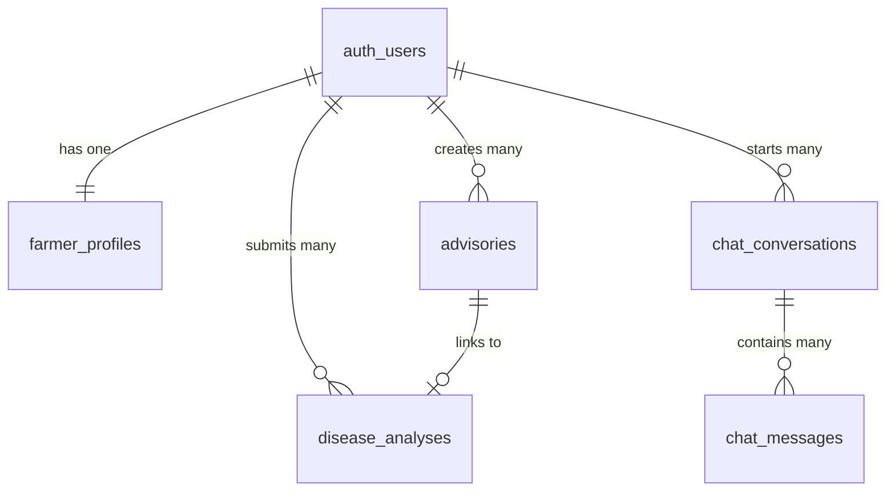

# AgroPulse AI: Database Architecture & Schema Specification

The database utilizes **PostgreSQL 15+** managed via Supabase, with complete **Row Level Security (RLS)** enforcement.

---

## 1. Entity-Relationship Summary

---

## 2. Table Specifications

### 2.1 `public.farmer_profiles`
Stores agricultural land specifications, topsoil typology, and farmer preferences.

| Column | Type | Constraints | Description |
| :--- | :--- | :--- | :--- |
| `id` | `UUID` | `PRIMARY KEY, REFERENCES auth.users(id) ON DELETE CASCADE` | Linked to Supabase Auth user |
| `full_name` | `TEXT` | `NOT NULL` | Farmer full name |
| `phone` | `TEXT` | `NULLABLE` | Contact phone number |
| `state` | `TEXT` | `NULLABLE` | State (e.g. Karnataka) |
| `district` | `TEXT` | `NULLABLE` | District (e.g. Mandya) |
| `village` | `TEXT` | `NULLABLE` | Village / Locality |
| `preferred_language` | `TEXT` | `NOT NULL DEFAULT 'en' CHECK (IN ('en', 'kn'))` | Language preference |
| `farming_experience_years` | `INTEGER` | `CHECK (>= 0)` | Experience |
| `farm_area` | `NUMERIC` | `CHECK (> 0)` | Total acreage |
| `farm_area_unit` | `TEXT` | `CHECK (IN ('acres', 'hectares', 'guntas'))` | Land area unit |
| `soil_type` | `TEXT` | `NULLABLE` | Topsoil classification |
| `irrigation_type` | `TEXT` | `NULLABLE` | Irrigation infrastructure |
| `farming_type` | `TEXT` | `NULLABLE` | Farming system |
| `created_at` | `TIMESTAMPTZ`| `NOT NULL DEFAULT NOW()` | Record creation |
| `updated_at` | `TIMESTAMPTZ`| `NOT NULL DEFAULT NOW()` | Trigger-updated |

---

### 2.2 `public.advisories`
Main persistence log for all structured Gemini AI agronomic outputs.

| Column | Type | Constraints | Description |
| :--- | :--- | :--- | :--- |
| `id` | `UUID` | `PRIMARY KEY DEFAULT gen_random_uuid()` | Unique advisory ID |
| `user_id` | `UUID` | `NOT NULL REFERENCES auth.users(id) ON DELETE CASCADE` | Tenant owner |
| `advisory_type` | `TEXT` | `NOT NULL CHECK (IN ('crop_recommendation', 'disease_detection', 'fertilizer', 'irrigation', 'chat'))` | Category |
| `title` | `TEXT` | `NOT NULL` | Human-readable title |
| `input_data` | `JSONB` | `NOT NULL DEFAULT '{}'::jsonb` | Full input parameters sent |
| `result_data`| `JSONB` | `NOT NULL DEFAULT '{}'::jsonb` | Validated Gemini structured JSON |
| `language` | `TEXT` | `NOT NULL DEFAULT 'en' CHECK (IN ('en', 'kn'))` | Output language |
| `model_name` | `TEXT` | `NULLABLE` | Model version used |
| `created_at` | `TIMESTAMPTZ`| `NOT NULL DEFAULT NOW()` | Timestamp |
| `updated_at` | `TIMESTAMPTZ`| `NOT NULL DEFAULT NOW()` | Timestamp |

---

### 2.3 `public.disease_analyses`
Specialized records for multimodal leaf image plant pathology diagnostics.

| Column | Type | Constraints | Description |
| :--- | :--- | :--- | :--- |
| `id` | `UUID` | `PRIMARY KEY DEFAULT gen_random_uuid()` | Scan ID |
| `user_id` | `UUID` | `NOT NULL REFERENCES auth.users(id) ON DELETE CASCADE` | Tenant owner |
| `advisory_id`| `UUID` | `REFERENCES public.advisories(id) ON DELETE SET NULL` | Parent advisory |
| `crop_name` | `TEXT` | `NOT NULL` | Crop scanned |
| `image_path` | `TEXT` | `NULLABLE` | Storage path in `crop-images` |
| `symptoms` | `TEXT` | `NULLABLE` | Farmer's observations |
| `result_data`| `JSONB` | `NOT NULL DEFAULT '{}'::jsonb` | Pathology response |
| `created_at` | `TIMESTAMPTZ`| `NOT NULL DEFAULT NOW()` | Timestamp |

---

### 2.4 `public.chat_conversations` & `chat_messages`
Stores conversation history for the 24/7 AI Farming Assistant.

---

## 3. Storage Bucket: `crop-images`
- **Visibility**: Private.
- **Max File Size**: 5,242,880 bytes (5MB).
- **MIME Types**: `image/jpeg`, `image/png`, `image/webp`.
- **Path Pattern**: `{user_id}/{timestamp}-{random}.ext`
- **Security**: Upload and read operations require matching `auth.uid() = (storage.foldername(name))[1]`.

